<div align="center">

# 🛡️ SHIELD-MATLAB

### Self-Healing Industrial Equipment and Link Diagnostics Using MATLAB Simulation


*A communication-aware fault-management simulation for a three-station industrial production line.*

**Author:** Adharsh V · B.E. ECE, Saveetha Engineering College (Anna University)
**Last updated:** 10 October 2026

</div>

---

## 📑 Table of Contents

1. [Abstract](#1-abstract)
2. [Key Results at a Glance](#2-key-results-at-a-glance)
3. [Problem Statement](#3-problem-statement)
4. [Objectives](#4-objectives)
5. [Scope](#5-scope)
6. [System Architecture](#6-system-architecture)
7. [Methodology and Development Stages](#7-methodology-and-development-stages)
8. [Simulation Configuration](#8-simulation-configuration)
9. [Output Results by Stage (with Dates)](#9-output-results-by-stage-with-dates)
10. [Integrated Performance Analysis](#10-integrated-performance-analysis)
11. [Applications](#11-applications)
12. [Limitations](#12-limitations)
13. [Future Improvements](#13-future-improvements)
14. [Repository Structure](#14-repository-structure)
15. [How to Run](#15-how-to-run)
16. [Project Status](#16-project-status)
17. [References and Documentation Note](#17-references-and-documentation-note)

---

## 1. Abstract

SHIELD-MATLAB is a MATLAB-based industrial automation simulation that investigates the relationship between **communication-network faults, sensor abnormalities, adaptive control decisions, and production-line performance**. It models a simplified production line of three sequential stations connected through a simulated communication environment.

The simulation injects sensor faults, network latency, packet loss, and production interruptions. A fault-detection layer identifies selected sensor abnormalities, while an adaptive controller evaluates communication conditions and switches between **NORMAL**, **DEGRADED**, and **SAFE STOP** operating modes.

The adaptive controller is compared with a baseline controller using completed product count and total station downtime. In the reported run, the adaptive controller completed **38 vs 34 products** and reduced downtime from **100.2 to 50.2 station-seconds**.

> ⚠️ These findings are **preliminary**. They come from a single simulation run with unequal controller decision rules and require repeated trials and a fair, like-for-like comparison before broader conclusions can be drawn.

**Keywords:** MATLAB · industrial automation · fault detection · adaptive control · network latency · packet loss · production-line simulation · fault management · performance analysis

---

## 2. Key Results at a Glance

| Metric | Baseline | Adaptive | Change |
|---|---:|---:|---:|
| Completed products (300 s) | 34 | **38** | **+4 (≈ +11.8 %)** |
| Throughput (products/min) | 6.80 | **7.60** | +0.80 |
| Total station downtime | 100.2 station-s | **50.2 station-s** | **−50.0 (≈ −49.9 %)** |

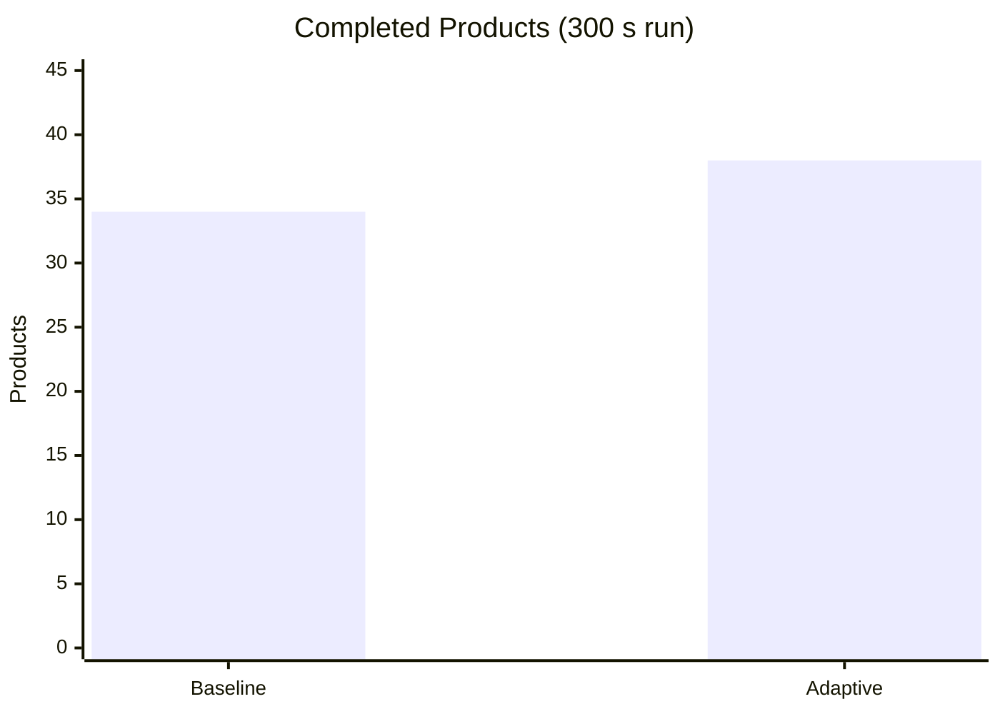

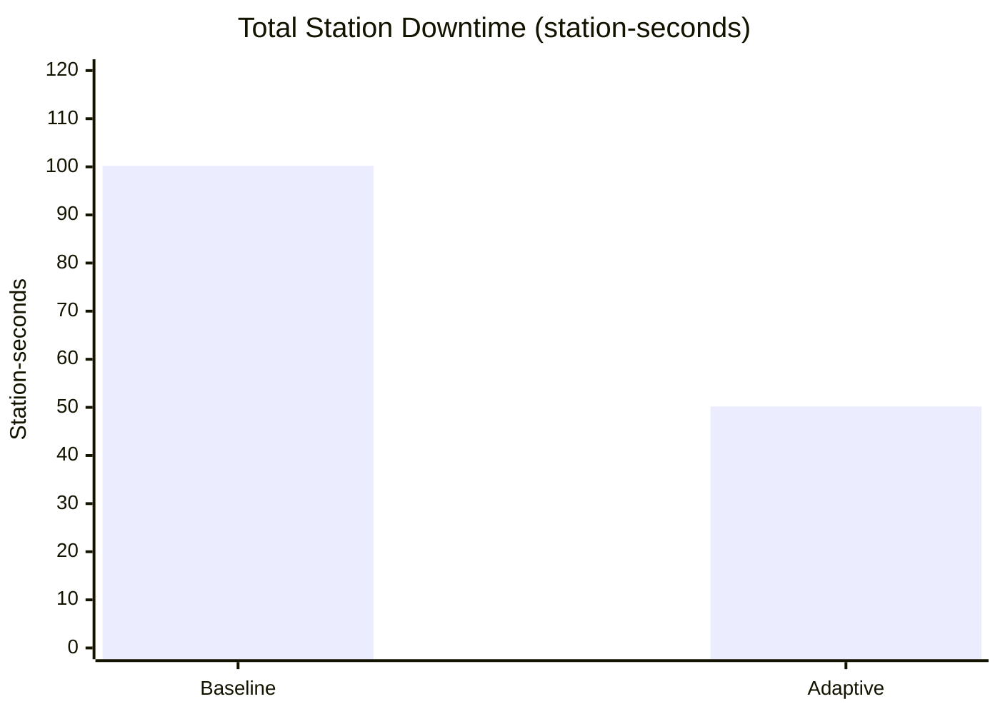

---

## 3. Problem Statement

Industrial production systems lose performance when sensor readings become unreliable, communication latency rises, packets are lost, or stations become unavailable. If these conditions are not detected or handled appropriately, they cause unnecessary interruptions, reduced throughput, and inefficient use of equipment.

This project asks: **can an adaptive controller that considers communication quality improve production performance compared with a simpler baseline strategy?**

The focus is on **simulation and algorithm evaluation**, not on building a real industrial control system.

---

## 4. Objectives

1. Develop a MATLAB simulation of a three-station industrial production line.
2. Simulate sensor abnormalities: stuck readings and missing measurements.
3. Model communication-network latency and packet loss.
4. Implement basic fault-detection logic for selected sensor and communication conditions.
5. Develop an adaptive controller with NORMAL, DEGRADED, and SAFE STOP modes.
6. Compare the adaptive controller with a baseline controller.
7. Measure completed products and total station downtime.
8. Examine the benefits and limitations of simulation-based adaptive fault management.
9. Establish a foundation for more advanced industrial automation and communication research.

---

## 5. Scope

**Included**

- Three sequential production stations with finite buffers
- Simulated sensor measurements with noise
- Stuck-sensor and missing-data scenarios
- Network latency and packet-loss scenarios
- Basic sensor fault detection and communication monitoring
- Adaptive operating-mode selection
- Baseline-vs-adaptive performance comparison
- Graphical and numerical result presentation

**Not included**

- A production-ready industrial controller
- A certified safety system
- A real industrial Ethernet network
- Hardware-in-the-loop testing

---

## 6. System Architecture

### 6.1 Functional Layers

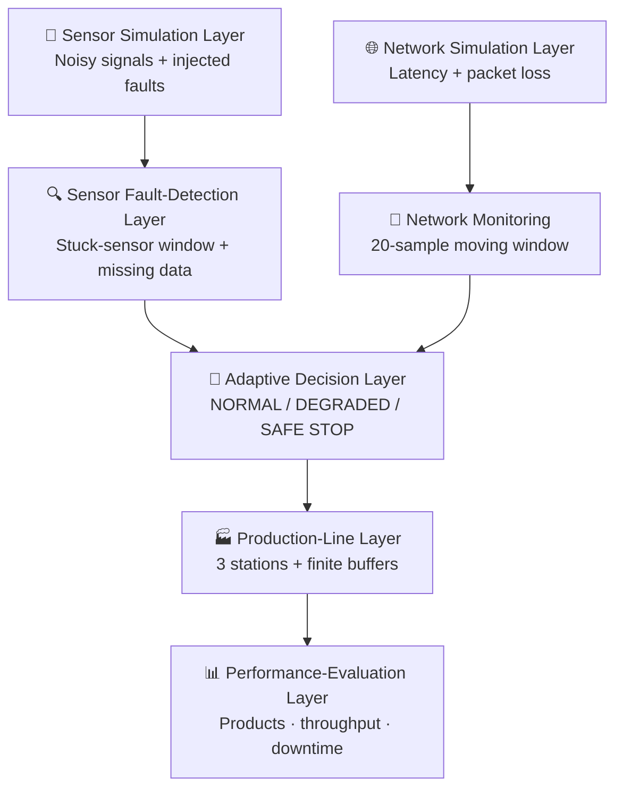

### 6.2 End-to-End Data Flow

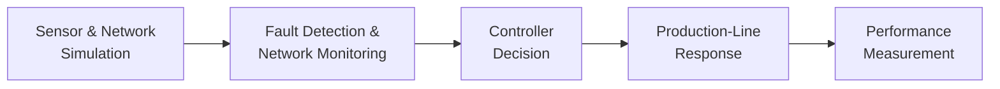

### 6.3 Production Line Model

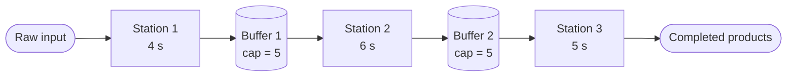

### 6.4 Adaptive Controller Decision Logic

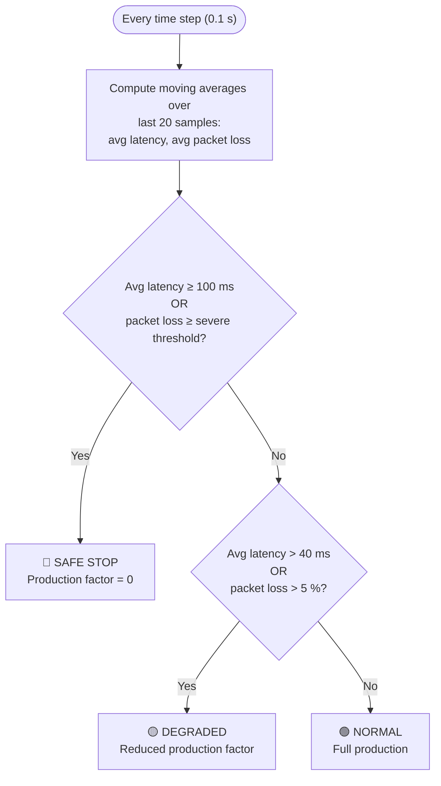

| Mode | Condition (configured) | Production response |
|---|---|---|
| 🟢 NORMAL | Latency and packet loss within normal limits | Full rate |
| 🟡 DEGRADED | Above normal limits (latency > 40 ms or loss > 5 %), below stop criteria | Reduced rate |
| 🔴 SAFE STOP | Avg latency ≥ 100 ms or severe packet loss | Production suspended |

### 6.5 Baseline vs Adaptive Controller

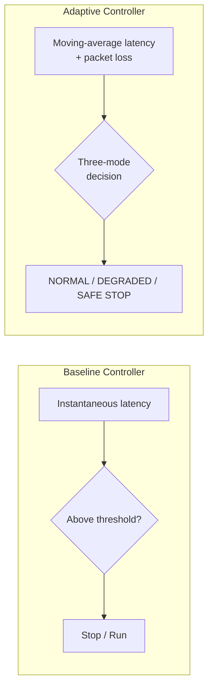

---

## 7. Methodology and Development Stages

The project was built incrementally; each component was tested before integration.

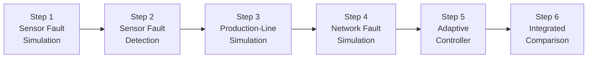

### Step 1 — Sensor Fault Simulation
Generates temperature-like signals for three stations with measurement noise. Two faults are injected:
- **Stuck sensor** at Station 2, 40–55 s
- **Missing readings** at Station 3, 70–85 s (51 lost packets)

### Step 2 — Sensor Fault Detection
A moving window of **10 samples** with a signal-range threshold of **0.03**. If variation in the window falls below the threshold, a stuck-sensor flag is raised; missing readings are detected separately.

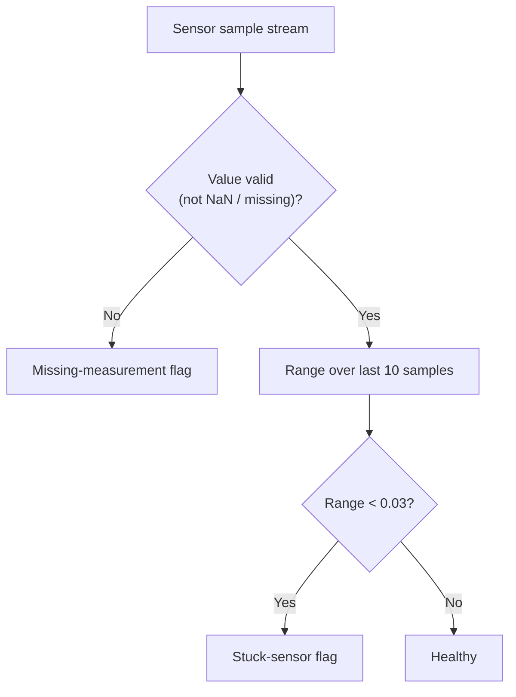

> Flag counts are **detector outputs**, not verified unique fault events. Consecutive flags can belong to one fault; false-positive/false-negative rates were not established.

### Step 3 — Production-Line Simulation
Three stations (4 s, 6 s, 5 s), finite buffers (capacity 5), and scheduled station outages (Station 1: 100–130 s, Station 2: 150–180 s, Station 3: 200–230 s).

### Step 4 — Network Fault Simulation
Adds varying latency and packet loss. A high-latency disturbance runs over 50–80 s; packet-loss rates differ by station. An early limitation was observed: the latency disturbance hit **all three stations in the same interval**, so faults were not fully isolated per station.

### Step 5 — Adaptive Controller
Uses a **20-sample moving window** and the thresholds below to select the operating mode:

| Parameter | Value |
|---|---|
| Normal latency reference | 40 ms |
| Critical latency threshold | 100 ms |
| Degraded packet-loss threshold | 5 % |
| Severe packet-loss threshold | 30 % |

### Step 6 — Baseline vs Adaptive Comparison
Both controllers run through the integrated three-station model with simulated latency, packet loss, and mode-dependent production response. Results are in [Section 10](#10-integrated-performance-analysis).

---

## 8. Simulation Configuration

| Setting | Value |
|---|---|
| Integrated simulation duration | 300 s |
| Time step | 0.1 s |
| Stations | 3 (sequential) |
| Nominal processing times | 4 s, 6 s, 5 s |
| Buffer capacities | 5 units each |
| Adaptive observation window | 20 samples |
| Normal latency reference | 40 ms |
| Critical latency threshold | 100 ms |
| Random seed | `rng(7)` (reproducible) |

**Fault schedule (integrated run)**

| Fault | Station | Interval | Packet loss |
|---|---|---|---|
| Moderate latency fault | Station 2 | 60 – 110 s | 10 % |
| Severe latency fault | Station 3 | 160 – 210 s | 40 % |

```mermaid
gantt
    title Integrated Fault Schedule (300 s run)
    dateFormat  X
    axisFormat  %s s
    section Station 2
    Moderate fault (10% loss) :60, 110
    section Station 3
    Severe fault (40% loss)   :160, 210
```

---

## 9. Output Results by Stage (with Dates)

All stages were run and recorded in MATLAB Online. Run/record date: **10 October 2026**.

| Stage | Script | Date Recorded | Key Output |
|---|---|---|---|
| Step 1 | `SHIELD_Step1_FaultSimulation.m` | 10 Oct 2026 | 120 s run · 1201 samples/station · Station 2 stuck 40–55 s · Station 3 lost packets: 51 |
| Step 2 | `SHIELD_Step2_FaultDetection.m` | 10 Oct 2026 | Station 2 stuck-sensor flags: **142** · Station 3 missing-measurement flags: **51** · Station 1: 0 / 0 |
| Step 3 | `SHIELD_Step3_ProductionLine.m` | 10 Oct 2026 | 300 s · **39 products** · **7.80 products/min** · downtime 30.1 s per station |
| Step 4 | `SHIELD_Step4_ProductionLine.m` (network) | 10 Oct 2026 | Packet loss S1/S2/S3: 0.00 % / 6.74 % / 10.49 % · mean latency ≈ 43.7–44.0 ms · 301 high-latency samples each |
| Step 5 | `SHIELD_Step5_AdaptiveController.m` | 10 Oct 2026 | Mode distribution (below) |
| Step 6 | `SHIELD_MasterSimulation.m` | 10 Oct 2026 | Baseline 34 vs Adaptive 38 products · 100.2 vs 50.2 station-s · +11.76 % |

**Step 5 controller mode distribution**

| Station | NORMAL | DEGRADED | SAFE STOP |
|---|---:|---:|---:|
| Station 1 | 100.0 % | 0.0 % | 0.0 % |
| Station 2 | 74.8 % | 25.0 % | 0.2 % |
| Station 3 | 73.9 % | 1.2 % | 24.9 % |

> These distributions are specific to the Step 5 fault schedule and do not apply to every simulation.

### 9.1 Output Screenshots

#### Step 1 — Sensor Fault Injection


#### Step 2 — Automatic Fault Detection


#### Step 3 — Production Line


#### Step 4 — Network Fault Simulation


#### Step 5 — Adaptive Controller


#### Step 6 — Integrated Evaluation


### 9.2 Meaning of Each Output

| Stage | Output shown in MATLAB | What it means |
|---|---|---|
| Step 1 | `Sampling interval: 0.10 seconds` | One sensor reading every 0.1 s (10 per second) |
| Step 1 | `Station 2 stuck-sensor interval: 40.0 to 55.0 seconds` | Station 2's sensor freezes on one value during this window while the real temperature keeps changing |
| Step 1 | `Station 3 lost packets: 51` | 51 readings never arrived (missing data, injected 70–85 s) |
| Step 1 | `Total samples per station: 1201` | 120 s ÷ 0.1 s + 1 |
| Step 2 | `Stuck-sensor flags: 142` (Station 2) | Samples flagged as stuck by the 10-sample window / 0.03 range rule; a detector output, not a count of separate faults |
| Step 2 | `Missing-measurement flags: 51` (Station 3) | Matches the 51 packets lost in Step 1 |
| Step 2 | Station 1: `0` / `0` | No fault detected, which is correct |
| Step 3 | `Products completed: 39` | Finished products in 300 s (standalone test) |
| Step 3 | `Average throughput: 7.80 products/minute` | 39 products ÷ 5 minutes |
| Step 3 | `Downtime: 30.1 seconds` per station | Each station was switched off for about 30 s |
| Step 4 | `Packet loss: 0.00 % / 6.74 % / 10.49 %` | Share of messages that never arrived at Stations 1 / 2 / 3 |
| Step 4 | `Mean simulated latency ≈ 44 ms` | Average network delay, raised by the 30 s high-delay disturbance |
| Step 4 | `High-latency samples: 301` | 301 samples = 30 s above the latency threshold; the same for all three stations, showing the disturbance was not isolated per station |
| Step 5 | `NORMAL / DEGRADED / SAFE STOP %` | Share of simulated time each station spent in each controller mode |
| Step 6 | `Completed products: 34` vs `38` | Baseline vs adaptive finished products in 300 s |
| Step 6 | `Throughput: 6.80` vs `7.60 products/minute` | Products per minute for each controller |
| Step 6 | `Total station downtime: 100.2` vs `50.2 station-seconds` | Downtime summed across stations; two stations down for 1 s count as 2 station-seconds |
| Step 6 | `Throughput difference: 11.76%` | ((38 − 34) ÷ 34) × 100 |

**Reading the figures**

| Figure | How to read it |
|---|---|
| Step 1 – Sensor Fault Injection | Black dashed = true temperature, blue = received measurement, red lines = fault start/end. A flat blue line marks the stuck sensor |
| Step 3 – Production Line | Top: cumulative products (flat = stalled). Middle: buffer levels vs capacity 5. Bottom: station available (1) or down (0) |
| Step 4 – Network Diagnostics | Latency in ms with a red threshold line, a packet-loss map (yellow = lost packet), and a high-latency flag (1 = above threshold) |
| Step 5 – Adaptive Controller | Blue = latency, orange = controller mode, dashed lines = 40 ms reference and 100 ms critical threshold |
| Step 6 – Integrated Evaluation | Top: cumulative products, baseline (dashed) vs adaptive (solid). Bottom: controller mode for Station 2 (blue) and Station 3 (orange) |

---

## 10. Integrated Performance Analysis

### 10.1 Completed Products
```
((38 − 34) / 34) × 100 = 11.76 %
```

### 10.2 Downtime Reduction
```
100.2 − 50.2 = 50.0 station-seconds
((100.2 − 50.2) / 100.2) × 100 = 49.90 %
```
Downtime is summed across stations, so the unit is **station-seconds**: two stations down simultaneously contribute two station-seconds per second of overlap.

### 10.3 Results Summary

| Performance metric | Baseline | Adaptive | Date recorded |
|---|---:|---:|---|
| Completed products | 34 | 38 | 10 Oct 2026 |
| Throughput (products/min) | 6.80 | 7.60 | 10 Oct 2026 |
| Total station downtime | 100.2 station-s | 50.2 station-s | 10 Oct 2026 |
| Difference in completed products | — | +4 | 10 Oct 2026 |
| Relative increase in products | — | ≈ 11.8 % | 10 Oct 2026 |
| Downtime reduction | — | 50.0 station-s | 10 Oct 2026 |
| Relative downtime reduction | — | ≈ 49.9 % | 10 Oct 2026 |

> The results describe **one reported run** and do not establish statistical significance, long-term reliability, or guaranteed performance in other scenarios.

### 10.4 Discussion
The adaptive controller translates communication indicators into operating modes, which in this model reduced the production impact of the faults. However, the comparison does not isolate the cause: the baseline uses instantaneous latency whereas the adaptive controller uses moving-window latency **and** packet loss. The result is evidence of behaviour **within the model**, not proof of equivalent gains in a real factory.

---

## 11. Applications

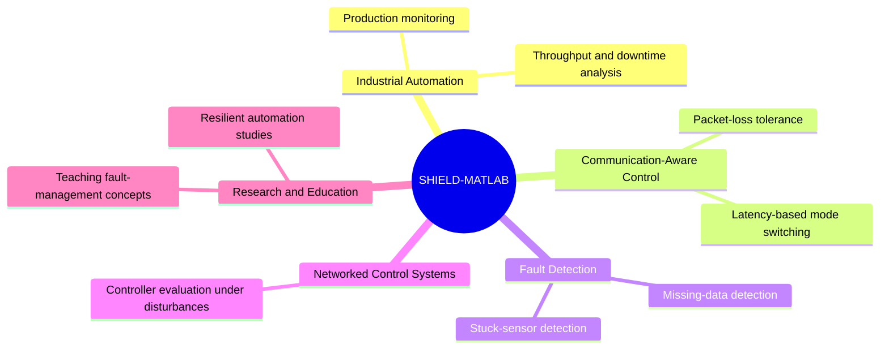

| Application area | How SHIELD-MATLAB relates |
|---|---|
| **Industrial automation & production monitoring** | Demonstrates how station availability and buffer behaviour respond to disruptions |
| **Communication-aware control** | Shows controller mode selection driven by latency and packet-loss estimates |
| **Fault-detection algorithm development** | Provides a test bed for threshold/window-based sensor diagnostics |
| **Networked control-system simulation** | Models network disturbances feeding into control decisions |
| **Manufacturing throughput & downtime analysis** | Quantifies products completed and station-seconds lost |
| **Resilient automation research** | Foundation for studying graceful degradation and safe-stop strategies |
| **Control-strategy evaluation** | Compares strategies under identical simulated disturbance types |
| **Education & portfolio demonstration** | A modular, software-only project for learning and presenting systems integration |

> The current implementation is a **simulation prototype** and is not ready for deployment in industrial machinery.

---

## 12. Limitations

| # | Limitation | Detail |
|---|---|---|
| 1 | Simplified environment | Only three sequential stations; no parallel machines, complex routing, or maintenance constraints |
| 2 | Simplified communication model | No protocol, queueing, retransmission, congestion, or industrial Ethernet behaviour |
| 3 | Basic fault detection | Fixed window/threshold; stable-but-healthy signals may false-alarm, slow drifts may be missed; no precision/recall measured |
| 4 | Unequal controller rules | Baseline and adaptive use different information, so the cause of improvement is not isolated |
| 5 | Simplified production response | Degraded = reduced factor; safe stop = zero factor; not validated machine dynamics |
| 6 | Limited repetition | Single reported run; random latency can influence outcomes |
| 7 | No hardware validation | Not tested on real sensors, PLCs, networks, or equipment |
| 8 | No safety certification | SAFE STOP is a simulated state, **not** a certified safety function |

---

## 13. Future Improvements

```mermaid
flowchart LR
    F1["Paired experiments<br/>identical fault traces"] --> F2["Multiple random seeds<br/>mean ± variability"]
    F2 --> F3["Detector metrics<br/>precision · recall · delay"]
    F3 --> F4["Realistic machines<br/>variable times · failures"]
    F4 --> F5["Explicit packet delivery<br/>and timeouts"]
    F5 --> F6["Adaptive / predictive<br/>thresholds"]
    F6 --> F7["Recovery and restart logic"]
    F7 --> F8["Hardware-in-the-loop<br/>testing"]
```

1. Conduct paired experiments using identical fault traces for both controllers.
2. Repeat experiments with multiple random seeds and report average performance and variability.
3. Add detection precision, recall, false-positive rate, and detection delay.
4. Introduce variable processing times, realistic machine failures, and recovery delays.
5. Model packet delivery and communication timeouts explicitly.
6. Investigate adaptive thresholds or predictive fault detection.
7. Add recovery and restart logic after communication returns to acceptable levels.
8. Compare moderate, severe, intermittent, and combined faults.
9. Document assumptions, parameter choices, and limitations of each experiment.
10. If extended beyond simulation, investigate hardware-in-the-loop testing.

*These are potential improvements, not completed capabilities.*

---

## 14. Repository Structure

```
SHIELD-MATLAB/
├── README.md
├── SHIELD_Step1_FaultSimulation.m
├── SHIELD_Step2_FaultDetection.m
├── SHIELD_Step3_ProductionLine.m
├── SHIELD_Step4_ProductionLine.m        # network fault simulation
├── SHIELD_Step5_AdaptiveController.m
├── SHIELD_Step6_Performance...m         # comparison stage
├── SHIELD_MasterSimulation.m            # integrated baseline vs adaptive run
└── docs/
    └── images/                          # output screenshots used in this README
```

> Adjust file names to match your repository exactly.

---

## 15. How to Run

**Requirements**

| Item | Details |
|---|---|
| Main software | MATLAB, base installation only (no toolboxes required) |
| How it was run | MATLAB Online (matlab.mathworks.com) with a MathWorks account; MATLAB desktop also works |
| Browser | Any modern browser (Google Chrome used) for MATLAB Online |
| Hardware | None. No sensors, PLCs or network equipment needed |
| MATLAB features used | Scripts, time-series simulation, random noise (`rng(7)`), moving-window calculations, threshold detection, conditional control logic, finite-buffer modelling, plotting |
| Publishing | GitHub (README.md renders the Mermaid diagrams automatically) |

```matlab
% Run each stage in order
SHIELD_Step1_FaultSimulation
SHIELD_Step2_FaultDetection
SHIELD_Step3_ProductionLine
SHIELD_Step4_ProductionLine
SHIELD_Step5_AdaptiveController

% Run the integrated comparison
SHIELD_MasterSimulation
```

Each script uses `rng(7)` for reproducible results and prints a results summary to the Command Window along with figures.

---

## 16. Project Status

| Item | Detail |
|---|---|
| Project name | SHIELD-MATLAB |
| Full name | Self-Healing Industrial Equipment and Link Diagnostics Using MATLAB Simulation |
| Category | Industrial automation simulation and adaptive fault management |
| Environment | MATLAB |
| Type | Software-only simulation |
| Main components | Sensor fault simulation, sensor diagnostics, network latency/packet-loss simulation, adaptive controller, three-station production model, baseline comparison |
| Reported integrated results | 34 vs 38 products; 100.2 vs 50.2 station-seconds |
| Status | Integrated simulation prototype completed; preliminary comparison recorded |
| Validation | Preliminary; repeated controlled experiments not yet performed |
| Last updated | 10 October 2026 |

**Final assessment:** SHIELD-MATLAB is suitable as a portfolio-level simulation project when its results and limitations are described accurately. It demonstrates modelling and systems-integration skills without claiming to be a validated industrial product.

---

## 17. References and Documentation Note

The project was implemented as a MATLAB simulation using the parameters and design decisions described above. No external research papers, industrial standards, or third-party benchmarks were independently verified for this report.

If submitted as formal academic research, relevant literature on networked control systems, industrial communication reliability, sensor fault detection, and fault-tolerant automation should be reviewed and cited, and any claim of novelty or superiority over existing industrial methods must be supported by that literature.

---

<div align="center">

**Author:** Adharsh V · **Date:** 10 October 2026
*Simulation prototype — not a certified or deployable industrial system.*

</div>
